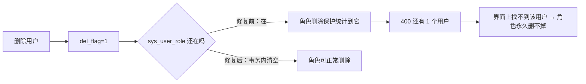

# 安全与数据一致性修复（P0 / P1 / P2）

> 日期：2026-11-06　｜　范围：`concise-server-node`
> 背景：上一轮「前后端整体冒烟测试」列出 20 条隐患，本轮把 P0（安全）与 P1（数据正确性）全部修完，
> 并顺手收口 P2 里的信任代理、Swagger 暴露、refreshToken 轮换、死代码四项。
> 回归结果：`scripts/smoke-test.cjs` **146 项全通过**（上一轮 130/136）。

---

## 一、改了什么（按风险排序）

| # | 问题 | 修法 | 主要文件 |
| --- | --- | --- | --- |
| P0-1 | 上传只限体积不限类型，`.html` 落盘后可直接访问 → 存储型 XSS | MIME 白名单 + **文件头 magic bytes 复核** + 落盘扩展名取识别结果 + 静态目录加 `nosniff`/严格 CSP/非图片强制下载 | `upload.controller.ts`、`upload.service.ts`、`utils/image-signature.util.ts`、`main.ts`、`utils/file.util.ts` |
| P0-2 | 缺安全响应头、暴露 `X-Powered-By` | 接入 `helmet`（CSP 交给静态目录与 Swagger，跨源策略放开） | `main.ts`、`package.json` |
| P0-3 | 无任何限流，验证码可关时登录接口裸奔 | 自研全局 `RateLimitGuard`（Redis / 内存双后端）+ `@RateLimit()` 装饰器 + 登录失败锁定 | `common/guards/rate-limit.guard.ts`、`common/decorators/rate-limit.decorator.ts`、`shared/rate-limit/*`、`auth.service.ts` |
| P1-4 | 软删用户不清关联表 → 角色被「已删用户」卡死 | 软删时事务内清 `sys_user_role` / `sys_user_depart`；角色删除保护只统计 `del_flag = 0`；新增迁移清理历史脏数据 | `user.service.ts`、`role.service.ts`、`migrations/1794000000000-*.ts` |
| P1-5 | 新建重复用户名直接 500 | 创建/更新前置唯一性校验（含软删占用）+ 捕获 `ER_DUP_ENTRY` 转 400 中文提示 | `user.service.ts`、`utils/db-error.util.ts` |
| P1-6 | 全项目 0 事务 | 用户创建/更新/删除、角色创建/更新/授权全部 `manager.transaction` 包裹 | `user.service.ts`、`role.service.ts` |
| P2-7 | `trust proxy = true` 可伪造审计 IP | 改为默认**不信任**，由 `TRUST_PROXY` 显式开启（跳数 / 网段） | `main.ts`、`.env.example` |
| P2-8 | Swagger 生产常开 | 生产默认关闭，`SWAGGER_ENABLED=true` 显式开启 | `main.ts`、`config/env.validation.ts` |
| P2-9 | refreshToken 不轮换 | 换发即拉黑旧 token；旧 token 超宽限期再用判定为泄露，踢该账号全部会话 | `auth.service.ts`、`online.service.ts`、`jwt.strategy.ts` |
| P2-10 | 批量删除静默忽略不存在的 id | `runBatchDelete` 接收完整 id 列表，查不到的进 `failed` 并说明原因 | `helper/crud/batch-delete.ts` + 8 个 service |
| P2-11 | 执行器下拉不提示「已被占用」 | `GET /v1/jobs/handlers` 返回 `occupied` / `jobId` | `job.service.ts` |
| P2-12 | 死代码目录 | 删除 `netdisk / sse / tasks / todo / health` 及 `system/` 下 5 个空目录（`system/task` 是真实模块，保留） | — |

---

## 二、逐项说明（怎么做的 / 为什么这么做）

### 1. 上传安全：三层校验，缺一不可

```ts
// ① multer fileFilter：声明的 Content-Type 不在白名单，直接拒（不落盘、不占内存缓冲）
// ② 文件头复核：把 .html 改名成 .png、Content-Type 填 image/png，这一步识破
// ③ 落盘扩展名取识别结果：文件名里的 .html 不会被保留，静态目录里永远只有位图
```

- 白名单：`png / jpeg / jpg / gif / webp / bmp`。**刻意不含 SVG** —— SVG 是 XML，可内嵌 `<script>`/`onload`，与本服务同源托管时等于送一个 XSS。
- 静态目录 `public/` 统一加：

| 响应头 | 值 | 作用 |
| --- | --- | --- |
| `X-Content-Type-Options` | `nosniff` | 禁止浏览器「猜类型」把文本当 HTML 执行 |
| `Content-Security-Policy` | `default-src 'none'; img-src 'self' data:; style-src 'unsafe-inline'; sandbox` | 即使有历史遗留 HTML，也执行不了任何脚本 |
| `Cross-Origin-Resource-Policy` | `cross-origin` | 允许 5173 前端取 3000 的图片 |
| `Content-Disposition` | `attachment`（非位图时） | 非图片一律下载，不在原地渲染 |

- 顺带修了**目录穿越**：`file.originalname` 完全可控（`../../x.png`），现在先 `path.basename` + 剔非法字符，`saveLocalFile` 里再做一次「目标路径必须在目录内」的兜底。

### 2. 限流与登录失败锁定

为什么自己写而不引 `@nestjs/throttler`：登录失败锁定需要「按账号累计失败次数」，与本守卫共用同一套计数器（Redis 优先、Redis 挂了退内存）比多引一层依赖更直接，也能精确控制中文文案与状态码。

| 维度 | 阈值 | 说明 |
| --- | --- | --- |
| 全局默认 | `RATE_LIMIT_LIMIT` 次 / `RATE_LIMIT_WINDOW` 秒（默认 120/60） | 按「IP + 方法 + 路由模板」计数，不同 id 不会被拆成不同桶 |
| 登录 | 60 次/分钟/IP | 防脚本洪水；阈值不宜太小，否则 NAT 后整个办公室互相误伤 |
| 验证码 | 30 次/分钟 | 生成一张图要跑 Jimp，属于 CPU 密集型 |
| 上传 | 30 次/分钟 | |
| **账号锁定** | 同账号连续 **5 次密码错误 → 锁 15 分钟** | Redis 共享，多实例一致；登录成功即清零 |

- 只有「账号密码错误」（`LOGIN_FAILED`）才计数；验证码错误、账号冻结、已锁定都不算密码尝试。
- 命中锁定返回 `429` + `code = 1009`，并提示还要等几分钟。
- 新增业务码：`RATE_LIMITED = 429`、`ACCOUNT_LOCKED = 1009`；`AnyExceptionFilter` 里补了 429 → 429 的映射与中文兜底。

### 3. 软删用户与角色死锁



- 软删时在同一个事务里 `DELETE FROM sys_user_role / sys_user_depart`，并清空冗余的 `depart_ids`、`org_code`。
- 角色删除保护只数 `del_flag = 0` 的用户（双保险：即便有历史脏数据也不会误判）。
- 迁移 `CleanupSoftDeletedUserRelations1794000000000` 把库里已有的孤儿关联行扫一遍（MySQL 多表 DELETE，幂等）。

### 4. 唯一键冲突：从 500 到 400

- 创建前查 `username / phone / email / workNo`，**不加 `del_flag` 过滤** —— 唯一索引不随软删释放，软删账号仍占着号；提示里会直接说明「该账号已删除，请换一个或先恢复」。
- 更新时排除自己（`Not(id)`），否则「只改姓名」也会被判成冲突。
- 并发写漏网的 `ER_DUP_ENTRY` 由 `runInTransaction` 捕获，翻译成中文 400，不再把 SQL 抛给用户。
- 顺带统一了提示口径：与角色编码、字典项 value 一样走 `BadRequestException`（HTTP 400）。

### 5. 事务边界

| 场景 | 事务内做了什么 |
| --- | --- |
| 创建用户 | 插主表 → 绑角色 → 绑部门 |
| 更新用户 | 更新主表 → 重绑角色 → 重绑部门 |
| 删除用户 | 清两张关联表 → 置 `del_flag=1` |
| 创建角色 | 插角色 → 绑菜单 |
| 更新角色 | 改角色 → 重绑菜单 |
| 授权菜单 | 读当前授权 → 计算差集 → 增删 |

实现细节：`assignMenus / assignRoles / assignDepts` 都加了可选的 `manager` 参数，事务内一律用 `manager.getRepository(...)`。
**踩坑**：`assignMenus` 最初用默认连接 `findOne` 校验角色，而刚插入的角色在另一个连接上还看不到 → 直接 404。已改为事务内仓库。

### 6. refreshToken 轮换

- 换发后立刻拉黑旧 refreshToken（黑名单值改存**时间戳**，不再存 `'1'`）。
- 旧 token 再次出现：10 秒内视为前端并发刷新（只 401）；超过 10 秒判定为泄露 → 写 `online:user-revoked:<userId>`，`JwtStrategy` 比对 `iat`，把该账号**所有**会话踢下线并记 `warn` 日志。
- **踩坑**：JWT payload 只有 `id/username/iat`（秒级），同一秒内签发的两个令牌完全相同 —— 轮换时「新 refreshToken === 旧 refreshToken」，刚签发就被自己拉黑。已在 payload 里加 `jti`（`randomUUID()`）。

### 7. 其他

- `trust proxy` 默认 `false`：本机直连时对端就是 127.0.0.1，若默认信任 `loopback`，攻击者手写的 `X-Forwarded-For` 反而会被采信（实测记成 `1.2.3.4`），等于白改。
- Swagger：`SWAGGER_ENABLED` 未设置时按 `NODE_ENV !== 'production'` 判定；文档描述里补了分页约定与新增业务码。
- 批量删除：`runBatchDelete(targets, handlers, requestedIds)`，第三个参数传前端提交的完整 id 列表，查不到的以「记录不存在或已被删除」进 `failed`。
- 定时任务：`GET /v1/jobs/handlers` 现在返回 `{ className, description, occupied, jobId }`，前端可把已占用的执行器置灰。
- 在线会话：`touch()` 加 60 秒降频，不再每个请求都写一次 Redis（`lastActive` 展示精度影响可忽略）。
- 登录接口 HTTP 状态从 201 改为 200（语义正确；前端只读 body，无影响）。

---

## 三、新增 / 变更的配置项

| 变量 | 默认 | 说明 |
| --- | --- | --- |
| `TRUST_PROXY` | 空（= 不信任） | 反代后面填 `loopback, 10.0.0.0/8` 或跳数 `2` |
| `SWAGGER_ENABLED` | 非生产为 true | 生产需要时显式 `true` |
| `RATE_LIMIT_ENABLED` | `true` | 本地压测可关 |
| `RATE_LIMIT_LIMIT` | `120` | 全局单 IP 单接口阈值 |
| `RATE_LIMIT_WINDOW` | `60` | 窗口秒数 |

均已在 `.env.example` 与 `src/config/env.validation.ts` 登记（写错格式会在启动期直接报错）。

---

## 四、怎么验证

```bash
# 1. 起一个关掉验证码的测试实例（不要动 3000 的开发实例）
cd E:/project/oneself/concise-server-node
PATH="/d/projram/nodejs:$PATH" PORT=3460 CAPTCHA_ENABLED=false node dist/main.js

# 2. 冒烟（146 项，含本轮新增的安全用例）
PATH="/d/projram/nodejs:$PATH" SMOKE_PORT=3460 node scripts/smoke-test.cjs
```

冒烟脚本新增的第 10、11 节覆盖：

| 用例 | 期望 |
| --- | --- |
| 伪装成 PNG 的 HTML | 400「文件内容不是有效的图片」 |
| `text/html` 上传 | 400「仅支持上传 PNG / JPEG …」 |
| 真实 PNG 上传 | 200，静态响应带 `nosniff` |
| 伪造 `X-Forwarded-For: 1.2.3.4` 后查登录日志 | 记为 `127.0.0.1` |
| 同账号连续 5 次密码错误 | 第 6 次 429 + `code 1009` |
| refresh 换发 | 新 refreshToken ≠ 旧 |
| 旧 refreshToken 重复使用 | 401 |
| 列表结构 | 3 个分页 / 6 个数组，符合文档约定 |

同时：`pnpm build` ✅、`pnpm lint` ✅、`pnpm lint:ox` 0 error（20 条既有 warning）、`pnpm test` 9 passed ✅。

---

## 五、没做的，以及为什么

| 项 | 原因 | 建议 |
| --- | --- | --- |
| 分页结构统一成 `{records,total}` | 属于 **breaking change**：`roles / depts / levels / posts / dicts / menus` 前端全部按数组消费（含树形选择器），一次改完要动 4 个页面 + 4 个 api 层，收益（这些是字典量级数据）远小于回归风险 | 已在 Swagger 里写明两套约定的边界；真要统一时按「列表页 → 下拉数据源」顺序灰度 |
| 密码算法 PBEWithMD5AndDES → argon2id | 换算法要处理「旧密码透明迁移」，是独立的登录链路改造 | 加 `password_algo` 字段，登录校验旧格式通过后顺手重写 |
| 权限集合缓存（每请求 3–5 次 IO） | 缓存要配「角色/菜单变更主动失效」，否则会出现「授权了但 30 秒后才生效」的玄学问题 | 先做 `lastActive` 降频（本轮已做），缓存后续按用户维度 + 变更事件推进 |
| 旧版 40 条 `/api/**` 路由下线 | 前端还有调用点，需要与前端同步排期 | 可先加 `Deprecation` 响应头提示 |
| 前端 `format:check` 20 个文件不合规 | 既有问题，批量格式化会产生巨大 diff | 单独一个 `style:` 提交 |

---

## 六、上线注意

1. **必须补配置**：`.env` 里新增的 `RATE_LIMIT_*`、`TRUST_PROXY`、`SWAGGER_ENABLED` 都有默认值，不填也能跑；但**部署在 Nginx 后面必须配 `TRUST_PROXY`**，否则审计日志里的 IP 全是反代地址。
2. **跑一次迁移**：`pnpm migration:run`（清理软删用户遗留的角色/部门关联）。
3. **Redis**：限流在 Redis 不可用时会自动退化为进程内计数（单实例有效、多实例会各算各的），生产建议保持 `REDIS_ENABLED=true`。
4. **登录路径变化**：现在返回 HTTP 200（原来是 201），如果有网关按 201 判断成功需要同步调整。
